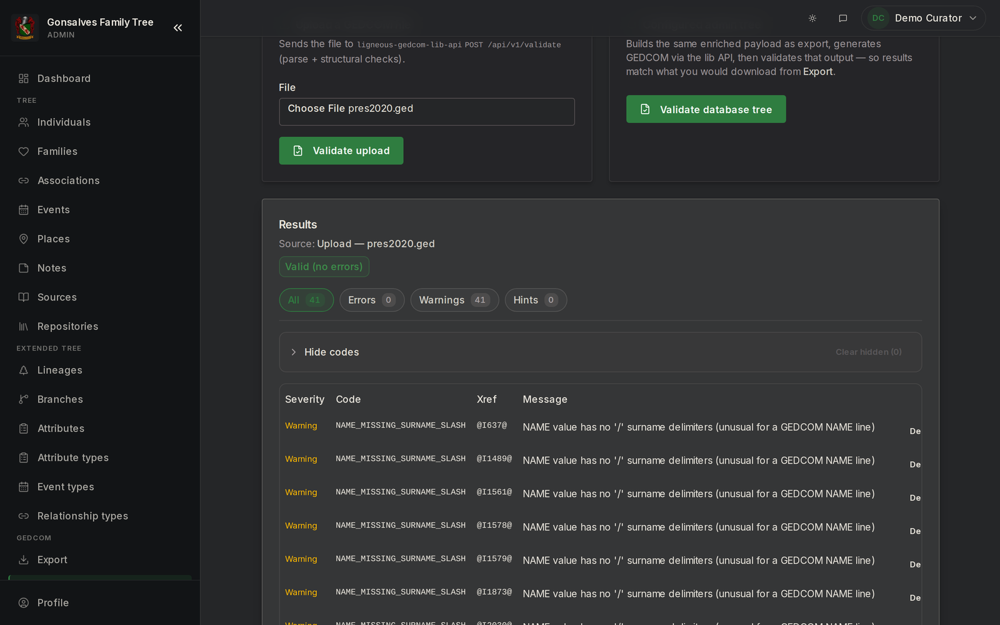

# ligneous-gedcom-lib

A Go library that parses GEDCOM genealogy files, validates them, and turns them into a normalized, database-ready form that the Ligneous web apps import.

Part of [Ligneous](https://github.com/lesfleursdelanuitdev/Ligneous).

**Architecture:** [docs/ARCHITECTURE.md](docs/ARCHITECTURE.md)

```
go get github.com/lesfleursdelanuitdev/ligneous-gedcom-lib
```

## Screenshots

These come from the Gonsalves family site and its admin app running on a demo database, loaded with the public US-presidents sample tree (`pres2020.ged`) through the real import pipeline. No family data is shown.



*The validator's findings for `pres2020.ged`, shown in the admin app (41 warnings, 0 errors).*


*The enriched import summarized before anything is written: 2,322 people, 1,115 families, 3,539 events.*

## What it does

GEDCOM is the plain-text format that genealogy programs (Gramps, Family Tree Maker, webtrees, PAF) use to exchange family trees. Each line has a level number, an optional cross-reference id, a tag and a value:

```
0 @I1@ INDI
1 NAME John /Doe/
1 BIRT
2 DATE ABT 1950
2 PLAC Boston, Suffolk, Massachusetts, USA
```

The library takes a file like this through four steps:

1. **Parse** it into a lossless tree (`gedcom.GedcomDocument`).
2. **Validate** the tree and report findings with stable codes, such as `ORPHANED_FAMC`, `DEATH_BEFORE_BIRTH` or `MOTHER_TOO_YOUNG_AT_CHILD_BIRTH` (37 codes in `validator/codes.go`).
3. **Enrich** the tree into flat, deduplicated tables (`enricher.EnrichedDocument`): people, families, parsed dates, split places, names, events, notes, sources, media, and parent/child, spouse and associate edges.
4. **Export** back to GEDCOM, denormalized JSON or CSV, either from the raw tree or from the enriched tables.

It also has two smaller pieces:

- `reconciliation` compares two enriched snapshots of a tree and produces a merge plan (matched people, diffs and conflicts). It does not write anything.
- `pedigreedoc` encodes mixed biological and adoptive parentage in GEDCOM using a `FAMC.PEDI birth` plus a machine-readable inline `NOTE`.

## Why Go

The parser is written in Go because Go is good at two things this project needs: writing a parser, and serving many requests at the same time.

**Parser-friendly properties you can see in the code:**

- **Line-based reading from any `io.Reader`.** `parser.ParseWithOptions` strips a UTF-8 BOM, then reads with `bufio.Scanner` (`parser/parser.go:84`). Each line is split into level, xref, tag and value by `parseSingleLine`.
- **A simple stack builds the tree.** `buildRecord` (`parser/parser.go`) turns the flat list of lines into nested records in one pass using a level stack. GEDCOM's level numbers map directly onto this.
- **Static types for the data model.** Every record, edge and lookup row is a Go struct with JSON tags (`gedcom/types.go`, `enricher/types.go`). The compiler catches shape mismatches between the parser, enricher and exporters.
- **Errors carry line numbers.** `parser.ParseError` records the line, message and context, and wraps the underlying error so callers can use `errors.Is`/`errors.As`.
- **Cancellation.** `parser.Options.Context` lets a caller cancel or time out a parse (`parser/parser.go:43-49` and `57-63`).
- **One dependency.** The only third-party module is `github.com/google/uuid` (used by `enricher.GenerateIDs`).
- **Fast, single static binary.** The HTTP service built on this library compiles with `CGO_ENABLED=0` into one binary in a small Alpine image (see [ligneous-gedcom-lib-api](https://github.com/lesfleursdelanuitdev/ligneous-gedcom-lib-api)).

**Concurrency, stated precisely.** The library itself does not start goroutines. One call to `Parse`, `Validate` or `Enrich` runs on one goroutine. What it does provide is safe use from many goroutines at once: each call works only on its own input and output, and the package-level maps (tag lists, month names, event catalog) are read-only after start-up. The concurrency happens one level up. The HTTP API uses Go's `net/http` server, which handles each request on its own goroutine, so several uploads are parsed in parallel without locks.

**Measured speed** (`go test -bench` on the repo's benchmarks, 3 runs each, shared AMD EPYC server, so treat as rough):

| File | Size | People | Parse only | Parse + validate + enrich |
|---|---|---|---|---|
| `testdata/royal92.ged` | 500 KB | 3,010 | 23 ms | 157 ms |
| `testdata/pres2020.ged` | 1.1 MB | 2,322 | 38 ms | 138 ms |

## The intermediate representation (IR)

The library produces two IRs. Both are plain Go structs that serialize to JSON with `encoding/json`. The full field-by-field reference is in [docs/INTERMEDIATE_FORMAT.md](docs/INTERMEDIATE_FORMAT.md).

```
 .ged file
    |
    v
 parser.Parse()  ------------>  gedcom.GedcomDocument      lossless tree, one node per line
    |
    +--> validator.Validate() ->  []*validator.ValidationError
    |
    v
 enricher.Enrich() ---------->  enricher.EnrichedDocument  flat tables, deduplicated
    |
    v
 enricher.GenerateIDs()          optional: a UUID on every row
    |
    +--> JSON over HTTP (ligneous-gedcom-lib-api)
    |       |
    |       +--> ligneous-frontend: writes the tables into Postgres (Prisma)
    |       +--> the-gonsalves-family-admin: stores the JSON as a pending import for review
    |
    +--> exporter.EnrichedToGEDCOM / FromEnrichedToJSON / FromEnrichedToCSV
```

### 1. `GedcomDocument`: the lossless tree

Defined in `gedcom/types.go`. Every GEDCOM line becomes a `GedcomRecord` with `level`, `tag`, `xref`, `value` and ordered `children`. Level-0 records are sorted into `individuals`, `families`, `sources`, `notes`, `repositories`, `media` and `submitters`. Order is preserved so the tree can be written back out as GEDCOM.

```json
{
  "level": 0, "tag": "INDI", "xref": "@I1@",
  "children": [
    { "level": 1, "tag": "NAME", "value": "John /Doe/" },
    { "level": 1, "tag": "SEX",  "value": "M" },
    { "level": 1, "tag": "BIRT", "children": [
      { "level": 2, "tag": "DATE", "value": "ABT 1950" },
      { "level": 2, "tag": "PLAC", "value": "Boston, Suffolk, Massachusetts, USA" }
    ]},
    { "level": 1, "tag": "FAMC", "value": "@F1@" }
  ]
}
```

### 2. `EnrichedDocument`: the normalized tables

Defined in `enricher/types.go`. This is the IR the front ends consume. Each slice mirrors a Postgres table (`gedcom_individuals_v2`, `gedcom_dates_v2`, `gedcom_parent_child_v2` and so on). Rows point at each other in two ways:

- people and families by GEDCOM xref (`"@I1@"`)
- lookup rows (dates, places, names, events, notes, sources, media) by **slice index**, with `-1` meaning "none"

Dates are parsed into type (`EXACT`, `ABOUT`, `BETWEEN`, ...), calendar and year/month/day. Places are split into name, county, state and country. Dates and places are deduplicated by hash. UUIDs are not assigned during enrichment. Call `enricher.GenerateIDs` when you need them for database rows.

This is real output for the file above plus a mother `@I2@` in family `@F1@`, trimmed to a few tables. Top-level keys are Go field names (`Individuals`, `Dates`); row fields use snake_case JSON tags. Empty tables serialize as `null`.

```json
{
  "Individuals": [
    { "xref": "@I1@", "full_name": "John /Doe/", "sex": "M",
      "birth_date_index": 0, "birth_place_index": 0,
      "death_date_index": -1, "death_place_index": -1,
      "primary_surname_lower": "doe", "birth_country": "USA" }
  ],
  "Dates":  [ { "original": "ABT 1950", "type": "ABOUT", "calendar": "GREGORIAN", "year": 1950, "hash": "30e2..." } ],
  "Places": [ { "original": "Boston, Suffolk, Massachusetts, USA", "name": "Boston",
                "county": "Suffolk", "state": "Massachusetts", "country": "USA", "hash": "f462..." } ],
  "Events": [ { "index": 0, "event_type": "BIRT", "event_label": "Birth",
                "date_index": 0, "place_index": 0, "owner_xref": "@I1@", "owner_type": "INDI" } ],
  "IndividualEvents": [ { "individual_xref": "@I1@", "event_index": 0, "role": "principal" } ],
  "ParentChild": [ { "parent_xref": "@I2@", "child_xref": "@I1@", "family_xref": "@F1@",
                     "parent_type": "mother", "relationship_type": "biological" } ]
}
```

### How the IR reaches the front end

The library does not talk to a database or serve HTTP. That is the job of [ligneous-gedcom-lib-api](https://github.com/lesfleursdelanuitdev/ligneous-gedcom-lib-api), a small Go service that vendors this library:

1. A user uploads a `.ged` file in a front end.
2. The front end's server route posts it to `POST /api/v1/parse-validate-enrich?generateIds=true`.
3. The API returns one JSON object: `document` (the tree), `warnings`, `validation`, `enriched` (the `EnrichedDocument`, with UUIDs) and `stats`.
4. `ligneous-frontend` (private) writes `enriched` into its `gedcom_*_v2` Postgres tables in one Prisma transaction (`app/api/trees/upload/route.js`, `lib/import/gedcom-import.js`). `the-gonsalves-family-admin` (private) saves the same JSON as a pending import for an admin to review.
5. For export, the front ends send an `EnrichedDocument` built from their database back to `POST /api/v1/export`, which returns GEDCOM, JSON or CSV.

## Package layout

| Package | Purpose |
|---|---|
| `gedcom` | `GedcomDocument` and `GedcomRecord` types, plus lookup helpers (`ChildrenByTag`, `FindByXref`, `XRefIndex`) |
| `parser` | GEDCOM text to `GedcomDocument`; BOM handling, line parsing, tree building, options and `ParseError` |
| `validator` | Structural, cross-reference, date and family-logic checks; 37 stable finding codes with severity (error, warning, hint) |
| `enricher` | `GedcomDocument` to `EnrichedDocument`; date and place parsing, name forms, events, attributes, residences, notes, sources, media, edges, UUIDs |
| `exporter` | Writes GEDCOM (with line wrapping), denormalized JSON and CSV, from a tree or from an `EnrichedDocument` |
| `reconciliation` | Compares two `EnrichedDocument`s and builds a merge plan: id and xref alignment, optional fuzzy matching with an optimal (min-cost) assignment, diffs and conflicts |
| `pedigreedoc` | Reads and writes the "mixed biological/adoptive parentage" note convention |
| `repair` | Fixes format problems that have one safe fix (encoding, byte order mark, line endings, blank lines, leading spaces, long lines, missing trailer) without changing the genealogical content; every fix or only the kinds you choose |
| `cmd/gedvalidate` | CLI: parse a file and print validator findings |
| `cmd/gedcomstdin` | CLI: read an `EnrichedDocument` as JSON on stdin and print GEDCOM |

Size: 7,842 lines of Go plus 3,826 lines of tests (18 test files).

## Usage

```go
f, err := os.Open("family.ged")
if err != nil { log.Fatal(err) }
defer f.Close()

doc, warnings, err := parser.Parse(f)          // GedcomDocument
if err != nil { log.Fatal(err) }

findings := validator.Validate(doc)             // []*ValidationError
ed := enricher.Enrich(doc)                      // EnrichedDocument
enricher.GenerateIDs(ed)                        // optional UUIDs

fmt.Println(len(warnings), len(findings), ed.Stats.Individuals)
gedcomText := exporter.EnrichedToGEDCOM(ed)     // back to GEDCOM
```

To repair a file's format, `repair.Repair(data)` applies every fix. To apply only some kinds, pass them by name:

```go
res, err := repair.RepairWithOptions(data, repair.Options{
    Fixes: []repair.Fix{repair.FixBlankLines, repair.FixLeadingSpace},
})
// res.Data: the repaired bytes (still in the file's own encoding without FixEncoding)
// res.Changes: what changed, each with its Fix; res.Left: codes still present
// res.Available: every kind this file could use, with line counts (every fix applied) and any reason it needs FixEncoding
// res.Applied: the lines each chosen kind really changed; res.Skipped: chosen kinds that changed nothing, and why
```

## Build, test and run

Requires Go 1.23.5 or later (`go.mod`).

```bash
go build ./...
go test ./...
go test -bench . ./enricher ./validator    # benchmarks over testdata/*.ged
```

All packages pass `go test ./...` (102 tests, checked 2026-10-09 with Go 1.24.4). 

The stress benchmarks in `parser/parser_stress_test.go` read large files from outside the repo (`../../ENFAN22.GED` and others) and skip when those files are missing.

CLI tools:

```bash
# Print validator findings for a file; exits 1 if there are errors
go run ./cmd/gedvalidate path/to/file.ged

# Turn an EnrichedDocument JSON ({"enriched": {...}}) on stdin into GEDCOM
go run ./cmd/gedcomstdin < payload.json > out.ged
```

## Test data

`testdata/` holds the GEDCOM files used by the tests and benchmarks: small hand-written files (`minimal55.ged`, `minimal551.ged`, `comprehensive551.ged`), malformed inputs in `testdata/malformed/`, and two larger, widely shared public sample files: `royal92.ged` (European royalty) and `pres2020.ged` (US presidents).

## Related repositories

- [Ligneous](https://github.com/lesfleursdelanuitdev/Ligneous): the umbrella project
- [ligneous-gedcom-lib-api](https://github.com/lesfleursdelanuitdev/ligneous-gedcom-lib-api): HTTP API over this library
- `ligneous-frontend` (private): Next.js app that imports the enriched data into Postgres
- [ligneous-gedcom-flask-api](https://github.com/lesfleursdelanuitdev/ligneous-gedcom-flask-api): Python research and analytics API over the same Postgres data
- `the-gonsalves-family-admin` (private): admin app that uses the API for GEDCOM import, export and merge plans
- `the-gonsalves-family` (private): the public family site that admin manages

## License

No license file: all rights reserved.
