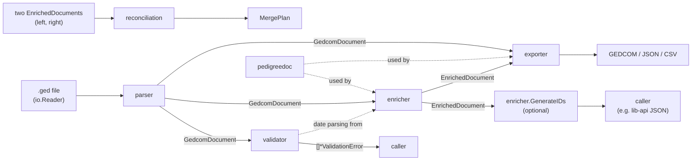

# Architecture: ligneous-gedcom-lib

## Summary

`ligneous-gedcom-lib` is a pure Go library with one third-party dependency (`github.com/google/uuid`). It reads a GEDCOM file into a tree, checks the tree, and flattens it into deduplicated tables that map onto the Ligneous Postgres schema. It can also write GEDCOM, JSON or CSV back out, and compare two versions of a tree to propose a merge plan. The library does no I/O beyond the `io.Reader` and `io.Writer` you pass it. It has no database code and no HTTP code. The HTTP service [ligneous-gedcom-lib-api](https://github.com/lesfleursdelanuitdev/ligneous-gedcom-lib-api) vendors it, and the web apps reach it through that service. The project map is in [Ligneous](https://github.com/lesfleursdelanuitdev/Ligneous).

## Components and data flow

Package imports, from `go list` (arrows point at what a package imports):

- `parser` -> `gedcom`
- `enricher` -> `gedcom`, `pedigreedoc`, `uuid`
- `validator` -> `gedcom`, `enricher` (it reuses the enricher's date parser)
- `exporter` -> `gedcom`, `enricher`, `pedigreedoc`
- `reconciliation` -> `enricher`, `uuid`
- `gedcom` and `pedigreedoc` import nothing from this module.

## Packages

| Package | Responsibility | Main files |
|---|---|---|
| `gedcom` | Tree types `GedcomDocument` and `GedcomRecord`, plus lookups (`ChildrenByTag`, `FindByXref`, `XRefIndex`) | `gedcom/types.go` |
| `parser` | Text to tree: BOM strip, line tokenizing, tree building, `Options`, `ParseError` | `parser/parser.go`, `parser/options.go`, `parser/errors.go` |
| `validator` | Structural, cross-reference, date and family-logic checks with 37 stable codes and three severities | `validator/validator.go`, `validator/codes.go`, `validator/date_checks.go` |
| `enricher` | Tree to flat tables: dates, places, names, events, attributes, residences, notes, sources, repositories, media, edges; optional UUIDs | `enricher/enricher.go`, `enricher/types.go`, `enricher/date.go`, `enricher/place.go`, `enricher/ids.go` |
| `exporter` | GEDCOM writer with line wrapping, denormalized JSON and CSV, from either IR | `exporter/gedcom.go`, `exporter/from_enriched.go`, `exporter/json.go`, `exporter/csv.go` |
| `reconciliation` | Compares two `EnrichedDocument`s and returns a `MergePlan` (alignments, diffs, conflicts) | `reconciliation/plan.go`, `reconciliation/soft_match.go`, `reconciliation/hungarian.go` |
| `pedigreedoc` | Reads and writes the note convention for mixed biological and adoptive parents | `pedigreedoc/pedigreedoc.go` |
| `cmd/gedvalidate` | CLI: print validator findings, exit 1 on errors | `cmd/gedvalidate/main.go` |
| `cmd/gedcomstdin` | CLI: `EnrichedDocument` JSON on stdin to GEDCOM on stdout | `cmd/gedcomstdin/main.go` |

## Key data structures

The library has two intermediate representations. The [README](../README.md#the-intermediate-representation-ir) shows a JSON example of each, and [INTERMEDIATE_FORMAT.md](INTERMEDIATE_FORMAT.md) lists every field.

- **`gedcom.GedcomDocument`** (`gedcom/types.go`). One `GedcomRecord` per GEDCOM line, with `Level`, `Xref`, `Tag`, `Value` and ordered `Children`. Level-0 records are sorted into `Individuals`, `Families`, `Sources`, `Notes`, `Repositories`, `Media` and `Submitters`, plus `Header` and `Trailer`.
- **`enricher.EnrichedDocument`** (`enricher/types.go`). Slices that mirror the `gedcom_*_v2` Postgres tables: entities (`Individuals`, `Families`), deduplicated lookups (`Dates`, `Places`, `Surnames`, `GivenNames`), `Events`, `Attributes`, `Residences`, relationship edges (`Spouses`, `ParentChild`, `FamilyChildren`, `Associates`) and many junction tables. People and families point at each other by xref. Everything else is referenced by slice index, with `-1` for none. The struct also holds a `Document` pointer back to the source tree.
- **`validator.ValidationError`**. `Severity` (0 hint, 1 warning, 2 error), `Code`, `Message`, `Xref`, `RelatedXref`, `AssociatedXrefs` and a `Details` map.
- **`reconciliation.MergePlan`**. Proposed alignments with scorecards, per-person and per-family diffs, and conflicts. `SafeAutoMerges` is always empty in this version (`reconciliation/plan.go`).

## Processing lifecycle

A typical call sequence is `parser.Parse` -> `validator.Validate` -> `enricher.Enrich` -> `enricher.GenerateIDs`.

1. **Read lines.** `parser.ParseWithOptions` checks the context, strips a UTF-8 BOM, and scans lines with `bufio.Scanner`. Each line is split into level, optional xref, tag and value (`parseSingleLine`). Empty lines and lines over 255 characters become warnings. A bad level, a missing tag or a level above `MaxNestingDepth` (default 100) stops the parse with a `*ParseError`.
2. **Build the tree.** `buildDocument` groups lines into level-0 blocks. `buildRecord` nests each block with a level stack in one pass. `classifyRecord` files the record by tag.
3. **Validate.** `ValidateWithOptions` runs structure, individual, family, header, genealogy-warning, cross-reference and association checks. Strict year checks run only when `Options.DateConsistency` is true. Each finding gets its `AssociatedXrefs`.
4. **Enrich.** `Enrich` creates a fresh `enricherState` with its own dedup maps, then runs phases in a fixed order: individuals, families, associations, relationship edges, sources, repositories, media, notes. Notes go last so they can link to events and sources. Dates and places are parsed, then deduplicated by a SHA-256 hash of the original text plus the parsed fields (`hashDateFields`, `hashPlaceFields`). Two rows merge only when the original text is identical. `Stats` holds the row counts.
5. **Assign IDs (optional).** `GenerateIDs` writes a new UUID into the `ID` field of every row in place.
6. **Export or reconcile.** `exporter.EnrichedToGEDCOM` rebuilds a fresh `GedcomDocument` from the tables (`FromEnriched`) and writes it with line wrapping. `reconciliation.BuildMergePlan` aligns people by stable `id`, then by xref, then optionally by fuzzy scoring within blocking buckets.

## Design decisions and tradeoffs

| Choice | Cost | Why |
|---|---|---|
| Two IRs: a lossless tree and flat tables | Two shapes to keep in sync, and two export paths (`ToGEDCOM` from the tree, `EnrichedToGEDCOM` from tables) | The tree keeps line order for faithful re-export. The tables match the database the apps import into. |
| Lookup rows referenced by slice index, `-1` for none | Indexes mean nothing outside one document, so importers must map them to database ids | Enrichment needs no id generator and stays deterministic. UUIDs are a separate, optional step. |
| Dedup dates and places by a hash that includes the original text | `Boston` and `Boston, MA` stay separate rows | Exact, cheap and predictable. No fuzzy place matching to get wrong. |
| Two-pass parse: all lines first, then the tree | The whole file and the whole tree sit in memory | The stack builder works on one level-0 block at a time and stays short (`parser/parser.go`). |
| Validation reports findings and never blocks | Callers must decide what is fatal | Real GEDCOM files are messy. The API returns `valid: false` only for error-severity findings. |
| Validator reuses `enricher.ParseDateString` | `validator` depends on `enricher` | One date parser, so validation and import agree on what a date means. |
| Reconciliation returns a plan and writes nothing | Apps must apply merges themselves | Merges in family data need human review. Persistence is out of scope (`reconciliation/doc.go`). |
| Hungarian assignment is opt-in, capped by `HungarianMaxMatrix` (default 64) | Greedy matching by default can pick a worse pairing | Greedy is cheap. The optimal step is a min-cost flow solved with Bellman-Ford (`reconciliation/hungarian.go`), so the cap keeps each bucket small. |
| One dependency (`google/uuid`) | Hand-written date, place and matching code | Small attack surface and an easy vendored build in the API. |

## Concurrency model

- The library starts no goroutines. A grep for `go func`, `sync.` and `chan` in non-test code finds nothing. Each call to `Parse`, `Validate`, `Enrich`, `GenerateIDs`, an exporter or `BuildMergePlan` runs on the caller's goroutine.
- Per-call state is local. `Enrich` allocates a new `enricherState` with its own maps. The parser keeps its line slice and stack in local variables.
- Package-level state is read-only after initialization. The maps are `individualEventTags`, `individualAttributeTags`, `familyEventTags`, `familyAttributeTags`, `monthMap`, `dateTypePrefixes` and `standardEventCatalog` in `enricher`, and the tag maps plus `individualSkipTags` and `familySkipTags` (built once at init) in `exporter`. No code writes to them after init. `mergeTagSets` copies into a new map. The remaining package variables are compiled `*regexp.Regexp` values, which Go documents as safe for concurrent use.
- So many goroutines can parse, validate and enrich different files at once without locks. The concurrency lives one level up: the API's `net/http` server runs each request on its own goroutine.
- Caveats: `Enrich` keeps a pointer to your input tree in `EnrichedDocument.Document`, and `GenerateIDs` mutates the document you pass. Do not hand the same `EnrichedDocument` to `GenerateIDs` from two goroutines. `exporter.CSVHeader` is an exported slice. The library only reads it, but a caller could change it.

## Error handling

- **Parser.** Fatal problems return `(nil, warnings, err)`, where `err` is a `*ParseError` with the line number, message and context. It wraps the cause, so `errors.Is` and `errors.As` work. Non-fatal problems come back as `[]*ParseError` warnings next to a usable document. A cancelled `Options.Context` returns `ctx.Err()`.
- **Validator.** Returns findings only, never a Go error.
- **Enricher.** Returns no error. A date it cannot parse becomes a row with type `UNKNOWN` and the original text kept.
- **Exporter.** Writer and CSV functions return the underlying I/O error.
- **Reconciliation.** `DecodeEnrichedDocument` and the options decoder return JSON errors. `BuildMergePlan` returns an empty plan for nil inputs.

## Testing

- `go test ./...` runs 102 top-level tests (166 with subtests) in 18 test files across six packages. All pass (checked 2026-10-09, Go 1.24.4).
- Fixtures in `testdata/`: hand-written minimal and comprehensive 5.5/5.5.1 files, six malformed inputs in `testdata/malformed/`, and two public sample files (`royal92.ged`, `pres2020.ged`).
- 11 benchmarks in `enricher/benchmark_test.go`, `validator/benchmark_test.go` and `parser/parser_stress_test.go`. Measured numbers are in the README.
- `exporter/roundtrip_stress_test.go` runs parse -> enrich -> export -> re-parse on large files, and the parser stress benchmarks do the same kind of work. Both read files from outside the repo and skip when they are missing.
- Per-test descriptions are in [TESTING.md](TESTING.md).

## Known limitations

- **Memory.** The parser keeps every line, then the full tree, and `Enrich` adds the tables on top. Peak memory grows with file size. There is no streaming mode.
- **Long lines.** `bufio.Scanner` runs with its default 64 KB token limit (`Buffer` is never called). A longer physical line ends the parse with "error reading input".
- **Cancellation is coarse.** The context is checked before and after line scanning, not inside the scan loop or during enrichment.
- **`Options.StrictMode` does nothing.** It is declared in `parser/options.go` and never read.
- **Unknown top-level records are dropped.** `classifyRecord` silently skips level-0 tags it does not know, so "lossless" holds only for the record types listed above.
- **Indexes are document-local.** Merging tables from two documents needs remapping.
- **No license file.** All rights reserved.

## How it connects to the other repos

- [ligneous-gedcom-lib-api](https://github.com/lesfleursdelanuitdev/ligneous-gedcom-lib-api) vendors this module and exposes parse, validate, enrich, export and reconcile over HTTP.
- `ligneous-frontend` (private) and `the-gonsalves-family-admin` (private) call that API and store the `EnrichedDocument` tables in Postgres through the shared `ligneous-prisma` (private) schema.
- [ligneous-gedcom-flask-api](https://github.com/lesfleursdelanuitdev/ligneous-gedcom-flask-api) reads those Postgres tables for analytics. It never calls this library directly.
- `the-gonsalves-family` (private) is the public family site that reads the same data.
